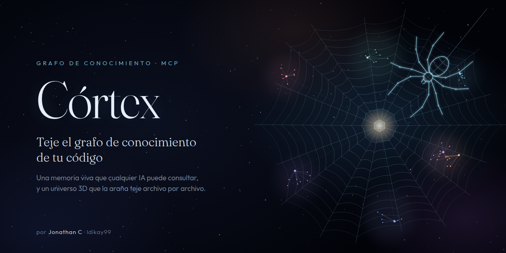
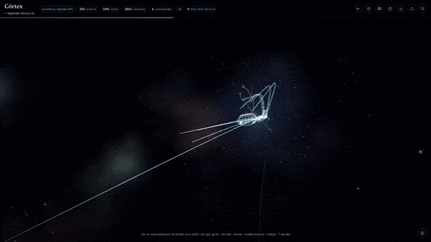
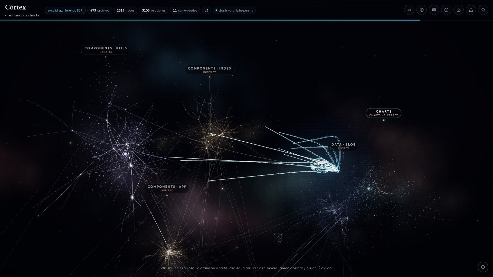
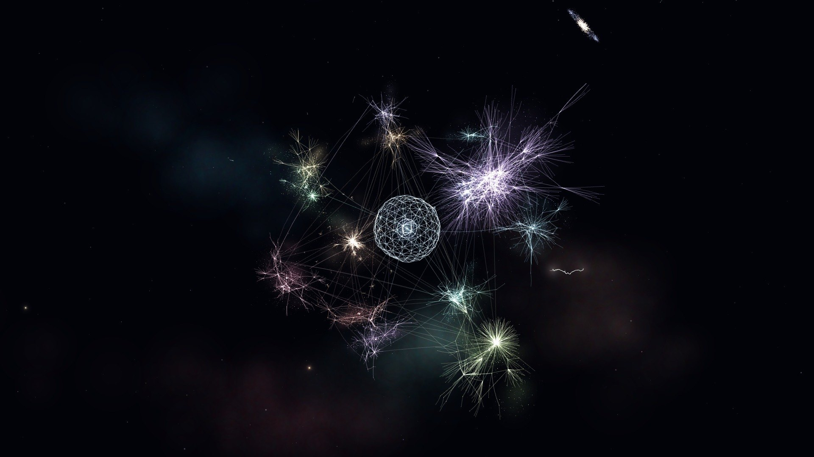
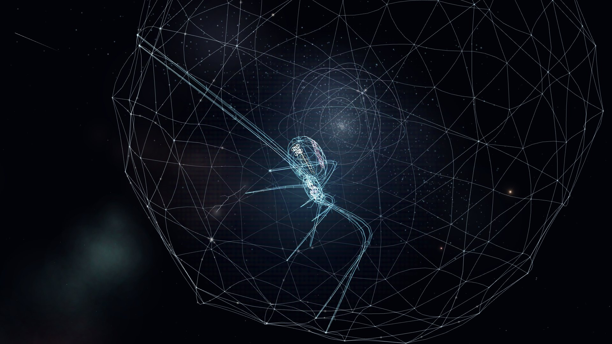
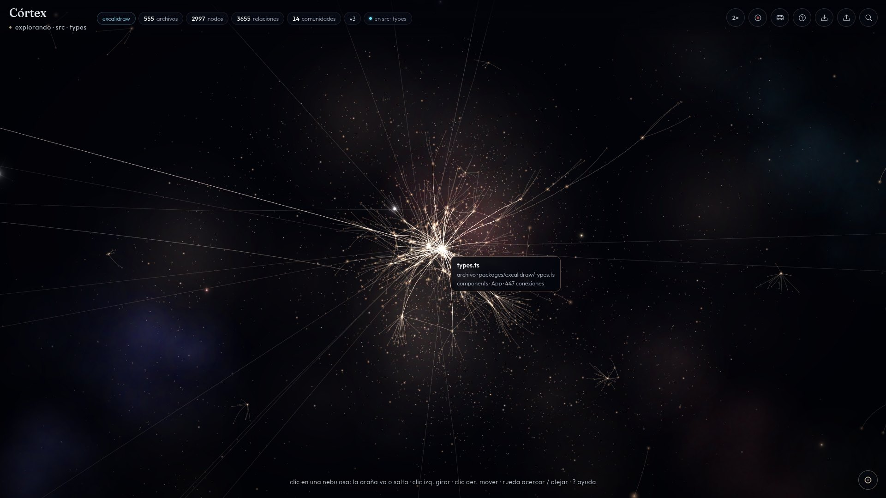
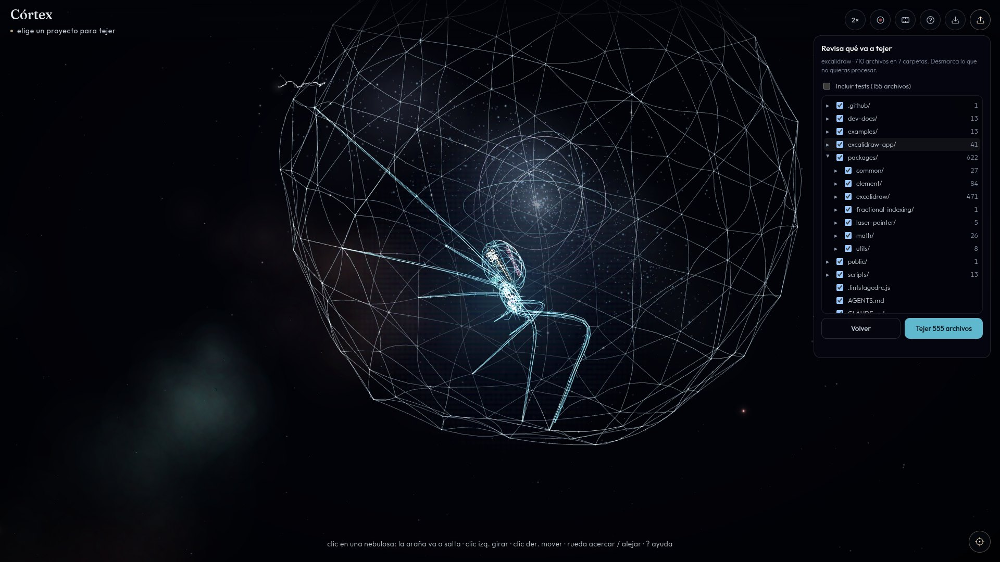
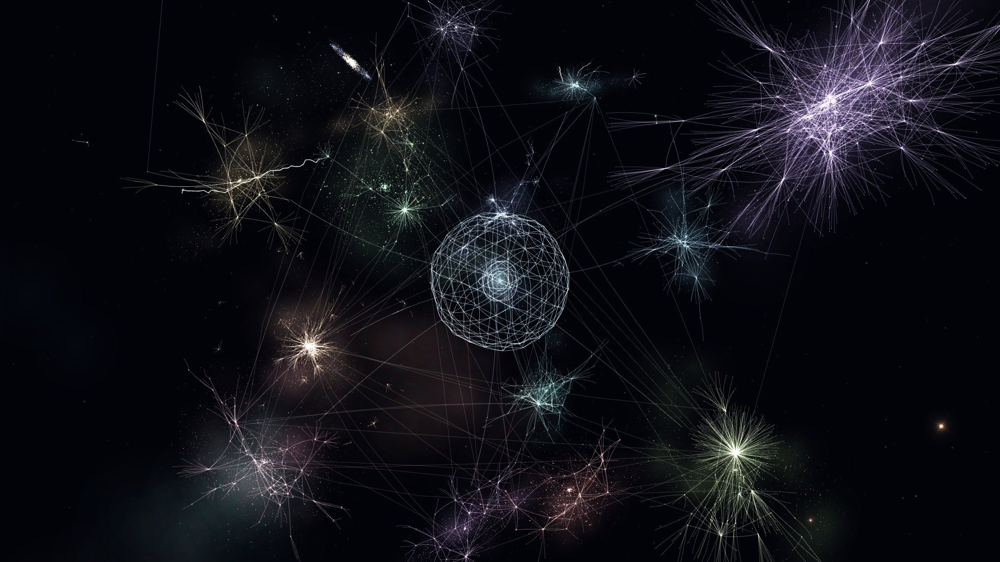

<p align="center">
  
</p>

<h3 align="center">Tu código, convertido en una memoria viva que cualquier IA puede consultar.</h3>

<p align="center">
  <em><b>TL;DR</b>: Córtex turns any repository into a living, versioned knowledge graph that AI agents query through MCP, a CLI or HTTP,<br />
  and renders it as a 3D universe woven file by file by a wireframe spider. Deterministic, local, one <code>docker compose up</code> away.</em>
</p>

<p align="center">
  <a href="LICENSE"></a>
  
  
  
  
</p>

<p align="center">
  
</p>

<p align="center">
  <a href="docs/media/demo.mp4"><b>▶ Ver el video</b></a> &nbsp;·&nbsp;
  <a href="#empieza-en-1-minuto">Empieza en 1 minuto</a> &nbsp;·&nbsp;
  <a href="#para-tu-ia">Para tu IA</a>
</p>

---

## Por qué

Toda IA que entra a un repositorio llega sin memoria. Abre archivos, adivina, vuelve a empezar.

**Córtex le entrega el mapa antes de la primera pregunta**, y te deja verlo nacer.

- **Memoria, no búsqueda.** Cada archivo, clase y función con su lugar exacto y sus vínculos. Tu IA deja de adivinar.
- **Recuerda lo que cambió.** Cada análisis es una versión; lo nuevo, lo modificado y lo que desapareció quedan registrados.
- **Siempre lo mismo.** Sin modelos ni tokens en el análisis: el mismo código, el mismo mapa.
- **Un espectáculo.** Tu arquitectura convertida en universo, lista para grabar.

## Galería

<table>
  <tr>
    <td width="50%"><p align="center"><sub>La araña teje archivo por archivo</sub></p></td>
    <td width="50%"><p align="center"><sub>Cada comunidad, una nebulosa</sub></p></td>
  </tr>
  <tr>
    <td><p align="center"><sub>El nido late en el centro</sub></p></td>
    <td><p align="center"><sub>Cada nodo, con su contexto</sub></p></td>
  </tr>
  <tr>
    <td><p align="center"><sub>Eliges qué se teje</sub></p></td>
    <td><p align="center"><sub>Tu código como fondo</sub></p></td>
  </tr>
</table>

## Para tu IA

Córtex trae un **servidor MCP** con 11 herramientas. Regístralo una vez (este repo ya incluye [`.mcp.json`](.mcp.json)):

```json
{
  "mcpServers": {
    "cortex": {
      "command": "docker",
      "args": ["exec", "-i", "cortex-analyzer", "cortex", "mcp"]
    }
  }
}
```

Y tu agente puede responder cosas como:

| Pregunta | Herramienta |
| --- | --- |
| «¿Qué se rompe si cambio `mutateElement`?» | `impact_analysis` |
| «¿Cómo llega la ruta `/login` hasta la tabla `users`?» | `find_path` |
| «¿Qué cambió desde la v2?» | `changes` |
| «¿Dónde vive la lógica de autenticación?» | `search_code` → `community_context` |

`list_projects` · `analyze_project` · `project_overview` · `search_code` · `node_context` · `file_context` · `community_context` · `find_path` · `impact_analysis` · `changes` · `get_report`

¿Sin MCP? Lo mismo está en la **CLI** (`cortex … --json`), en la **API HTTP** (`/api/query/overview|search|node|file|community|path|impact|changes`) y en disco: `datos/<proyecto>/grafo.md` es un reporte listo para pegar en el contexto de cualquier modelo.

## Empieza en 1 minuto

```bash
git clone https://github.com/ldikay99/Cortex.git && cd Cortex
docker compose up -d
```

Abre **http://localhost:8090**, elige una carpeta, un `.zip` o una URL de GitHub, revisa qué carpetas entran y pulsa **Tejer**.

> Para repos privados de GitHub: `GITHUB_TOKEN=ghp_… docker compose up -d`.

**Desde la terminal**, sin navegador:

```bash
docker exec cortex-analyzer cortex analyze https://github.com/excalidraw/excalidraw
docker exec cortex-analyzer cortex impact mutateElement --project excalidraw
```

**Para tu agente**: con los contenedores arriba, el `.mcp.json` de este repo basta. En otro proyecto, copia ese bloque a su configuración MCP.

<details>
<summary>Solo la CLI y el MCP, sin Docker</summary>

```bash
python -m venv .venv && . .venv/bin/activate
pip install -e analyzer
cortex analyze ./mi-repo        # guarda en ./datos/mi-repo/
cortex overview mi-repo
cortex mcp                      # servidor MCP por stdio
```

La web necesita el proxy de nginx hacia el analizador: para el universo 3D, usa `docker compose`.

</details>

## Por dentro

- Python, TypeScript, TSX, JavaScript y Markdown, unidos por imports, llamadas, herencia, rutas y tablas.
- Comunidades descubiertas solas, con nombre propio.
- Versiones con diff por contenido y un mapa que no se reacomoda.
- Todo vive en `datos/<proyecto>/`, legible sin abrir el navegador.

## Atajos

| Tecla | Acción |
| --- | --- |
| <kbd>/</kbd> | Buscar archivo, clase o función |
| <kbd>F</kbd> | Cámara que persigue a la araña |
| <kbd>H</kbd> | Modo cine (sin interfaz) |
| <kbd>?</kbd> | Ayuda y leyenda |
| <kbd>W</kbd> <kbd>A</kbd> <kbd>S</kbd> <kbd>D</kbd> <kbd>Q</kbd> <kbd>E</kbd> | Desplazar la cámara |
| <kbd>Esc</kbd> | Cerrar paneles |
| Clic en una nebulosa | La araña viaja hasta allí |

Velocidad del tejido de 0.5× a 4× desde la barra (o `?velocidad=2` en la URL). El botón ● graba un reel WebM solo de la escena 3D.

## Bajo el capó

**Web** Three.js · shaders propios · esbuild · nginx &nbsp;|&nbsp; **Analizador** Python 3.12 · ast · tree-sitter · igraph + leidenalg · NetworkX · MCP SDK &nbsp;|&nbsp; **Calidad** pytest · Playwright e2e · GitHub Actions &nbsp;|&nbsp; **Entrega** Docker Compose

Para agentes que trabajan en este repo: [`CLAUDE.md`](CLAUDE.md), [`AGENTS.md`](AGENTS.md), skills en [`.claude/skills`](.claude/skills) y subagentes en [`.claude/agents`](.claude/agents).

## Autor

<p>
  <a href="https://github.com/ldikay99"><b>Jonathan C (ldikay99)</b></a> · Colombia<br />
  Ingeniero de Software especializado en IA: ingeniería de prompts, skills y agentes, orquestación multiagente, MCP, entrenamiento y ajuste de modelos, RAG y grafos de conocimiento, plataformas de IA.
</p>

Si Córtex te sirve, una ⭐ ayuda a que más gente lo encuentre.

## Licencia

[MIT](LICENSE) © 2026 Jonathan C (ldikay99)
